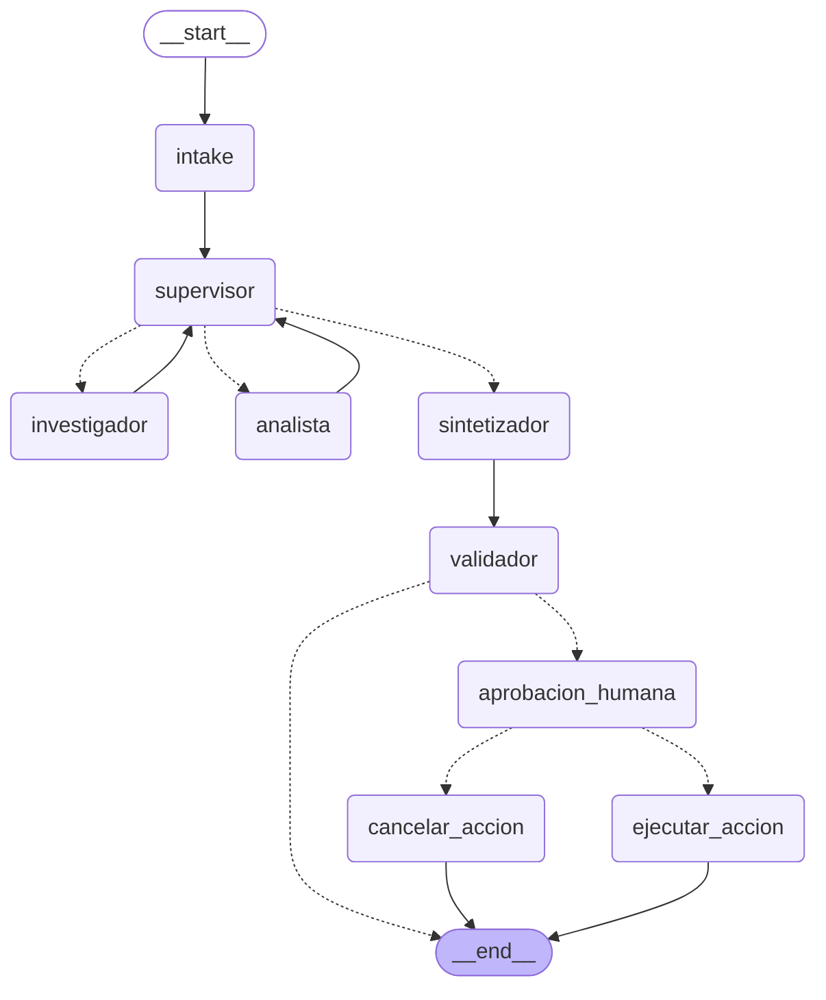

# API de producción y monitoreo activo — Pre-entrega 7

API REST (**FastAPI**) que expone el orquestador multi-agente de la Entrega 6 (BA Explore AI) con:

- **Endpoints asíncronos:** `POST /tasks` encola el trabajo y devuelve un `job_id` al instante.
- **Redis:** estado de los jobs y checkpoints de LangGraph.
- **Observabilidad:** trazas de cada nodo, tokens, costo y latencia en **Arize Phoenix** (OpenInference).
- **Human-in-the-loop:** pausa obligatoria con aprobación humana en tareas críticas.

## Arquitectura

```
cliente ──POST /tasks──► FastAPI ──► crea job (Redis: PENDING) ──► asyncio.Task (worker) ──► grafo LangGraph
   ▲                        │ 202 + job_id                              │                        │
   │                        │                                           ▼                        ▼
   └──GET /tasks/{id}──► lee estado en Redis ◄──── RUNNING/DONE/FAILED/AWAITING_APPROVAL   checkpoints en Redis
                                                                                              │
                                         trazas OpenTelemetry/OpenInference ──────────────► Phoenix
```

| Archivo | Rol |
|---|---|
| `app/main.py` | FastAPI: `POST /tasks`, `GET /tasks/{id}`, `GET /health`. Ciclo de vida (checkpointer, precarga de modelos). |
| `app/worker.py` | Ejecuta el job en segundo plano y actualiza el estado en Redis. Captura **toda** excepción → `FAILED`. |
| `app/jobs.py` | Estado de los jobs en Redis (hash `job:{id}`). |
| `app/graph.py` | Orquestador del Módulo 6 + checkpointer de Redis + rama HITL. |
| `app/hitl.py` | Nodo de aprobación humana (`interrupt`) y endpoint `POST /tasks/{id}/approve`. |
| `app/redis_checkpointer.py` | Checkpointer de LangGraph sobre Redis (ver nota más abajo). |
| `app/observability.py` | Inicialización de Phoenix y etiquetado de trazas por `job_id`. |
| `app/agents/`, `app/tools/` | Supervisor, investigador, analista, sintetizador y herramientas (Entrega 6). |
| `scripts/load_test.py` | Prueba de carga: 5 peticiones concurrentes, calcula p50/p95. |
| `scripts/configurar_precios_phoenix.py` | Registra en Phoenix el precio por token del modelo (para calcular el costo por ejecución). |
| `scripts/capturar_dashboard.py` | Capturas automáticas del dashboard de Phoenix. |
| `tests/` | 7 pruebas sin LLM ni Redis real (fakeredis). |

### Grafo



## Ciclo de vida de un job

```
PENDING → RUNNING → DONE
                 ├→ AWAITING_APPROVAL → RUNNING → DONE | REJECTED     (tareas críticas)
                 └→ FAILED                                            (excepción o timeout)
```

- **No bloquea el event loop:** el endpoint solo escribe en Redis y lanza una `asyncio.Task`; el grafo corre con `ainvoke`, las herramientas síncronas (requests, embeddings) las ejecuta LangGraph en un thread pool, y Redis se usa con `redis.asyncio`.
- **Errores en segundo plano:** el worker envuelve la ejecución en `try/except`; ante cualquier excepción o timeout (`JOB_TIMEOUT_S`) el job pasa a `FAILED` con `error` y `traceback` en Redis, para que el cliente nunca quede esperando en un polling infinito. Al arrancar, los jobs que quedaron `RUNNING`/`PENDING` de una ejecución anterior se marcan `FAILED`.
- **Concurrencia acotada:** un semáforo (`MAX_JOBS_CONCURRENTES`, 5 por defecto) limita los jobs simultáneos.

## Human-in-the-loop

Una tarea es **crítica** (`app/hitl.py::detectar_accion_critica`, reglas sin LLM) cuando implica:

| Tipo | Disparador | Motivo |
|---|---|---|
| `reserva` | "reservá…" | efecto secundario: crea una reserva |
| `envio_email` | "enviame… por mail" | efecto secundario: envía un correo |
| `costo_alto` | 3 categorías en radio ≥ 4 km | muchas llamadas a APIs y al LLM |

El grafo hace la investigación y el análisis, y **antes** de ejecutar la acción llama a `interrupt()`: el estado queda guardado en Redis y el job pasa a `AWAITING_APPROVAL`, con la propuesta concreta (qué lugar, qué acción). Hasta que alguien llame a `POST /tasks/{id}/approve` no se ejecuta nada. Las acciones son **simuladas**: se registran en Redis (`accion:{id}`), no se contacta ningún comercio.

```bash
curl -X POST localhost:8000/tasks -H "Content-Type: application/json" \
     -d '{"query": "Reservame una mesa en una parrilla de Recoleta"}'        # → {"job_id": "…", "status": "PENDING"}
curl localhost:8000/tasks/<job_id>                                             # → AWAITING_APPROVAL + approval_request
curl -X POST localhost:8000/tasks/<job_id>/approve -H "Content-Type: application/json" \
     -d '{"approved": true, "comentario": "ok"}'                              # → reanuda; luego DONE (o REJECTED si approved=false)
```

Como el checkpoint está en Redis y no en memoria, la pausa **sobrevive a un reinicio de la API** (cubierto por `test_la_pausa_sobrevive_a_un_reinicio`).

### Nota sobre el checkpointer de Redis

El paquete oficial `langgraph-checkpoint-redis` exige **Redis Stack** (módulos RedisJSON y RediSearch). Para que la API funcione con cualquier Redis (`redis:7`, Redis administrado, Redis local) implementé `RedisCheckpointSaver` sobre hashes y sorted sets. Implementa la interfaz asíncrona de `BaseCheckpointSaver` (checkpoints, escrituras pendientes —donde queda el `interrupt`—, listado y borrado). No tiene las optimizaciones del oficial (por ejemplo, guarda el checkpoint completo en cada paso).

## Cómo levantarlo

Requiere **Python 3.12+**, un Redis y una `GOOGLE_API_KEY` gratuita ([aistudio.google.com/apikey](https://aistudio.google.com/apikey)).

### Opción A — Docker Compose (Redis + Phoenix + API)

```bash
copy .env.example .env      # completar GOOGLE_API_KEY
docker compose up --build
# API:     http://localhost:8000/docs      Phoenix: http://localhost:6006
```

### Opción B — Local

```bash
python -m venv .venv && .venv\Scripts\activate      # Linux/macOS: source .venv/bin/activate
pip install -r requirements.txt
copy .env.example .env                              # completar GOOGLE_API_KEY

# 1. Redis (cualquiera de estas)
docker run -d -p 6379:6379 redis:7-alpine           # o un Redis local / Memurai en Windows

# 2. Phoenix (entorno aparte para no mezclar dependencias)
python -m venv .venv-phoenix && .venv-phoenix\Scripts\pip install arize-phoenix
.venv-phoenix\Scripts\python -m phoenix.server.main serve      # http://localhost:6006

# 3. API
uvicorn app.main:app --port 8000
```

Para correr los tests (no requieren Redis ni LLM): `pip install -r requirements-dev.txt && pytest -q`.

## Prueba de carga: 5 peticiones concurrentes

```bash
# una sola vez, con Phoenix ya levantado y ANTES de la carga: registra el precio por token del modelo
python scripts/configurar_precios_phoenix.py

python scripts/load_test.py --url http://localhost:8000 --concurrencia 5
```

Lanza 5 consultas a la vez, sondea cada job hasta que termina y escribe `load_test_resultado.json` con la latencia de cada uno (p50, p95, máximo). Luego, en Phoenix (`http://localhost:6006`, proyecto `ba-explore-api`) se leen el costo por ejecución, la latencia y qué nodo consume más tokens. Las capturas automáticas se generan con:

```bash
pip install playwright
python scripts/capturar_dashboard.py      # usa Edge/Chrome instalado; guarda en screenshots/
```

## Evidencias (`/screenshots`)

Corrida real: 5 peticiones simultáneas (`scripts/load_test.py`) contra la API, con Redis y Phoenix en Docker, Gemini `gemini-flash-lite-latest` y datos en vivo de OpenStreetMap. Resultado completo en [`load_test_resultado.json`](load_test_resultado.json).

| Métrica | Valor |
|---|---|
| Peticiones OK / fallidas | **5 / 0** (las 5 terminaron en `DONE`) |
| Latencia p50 (extremo a extremo, POST → `DONE`) | 176,6 s |
| Latencia **p95** | **219,7 s** (máx. 221,0 s) |
| Latencia del `POST /tasks` | 14 ms la primera; ~1,0–1,1 s las otras 4 (ver nota) |
| Tokens totales / llamadas al LLM | 49.889 tokens / 47 llamadas |
| **Costo total** (calculado por Phoenix) | **US$ 0,0060** → **≈ US$ 0,0012 por ejecución** |

**Qué nodo consume más:** `investigador` = 51 % de los tokens (25.486) y además es el cuello de botella de tiempo: 738 s acumulados en 9 ejecuciones, con la herramienta `buscar_lugares` (consulta a Overpass/OSM) tardando de 1 a ~2 min en varias corridas. Le siguen `supervisor` 27 % (13.633), `analista` 18 % (9.052) y `sintetizador` 3 % (1.718). Es decir, la latencia no la pone el LLM (el supervisor acumuló 73 s en 17 llamadas; el investigador, 738 s) sino la API pública de OpenStreetMap.

| Captura | Qué muestra |
|---|---|
| [`01_metricas_costo_tokens_latencia.png`](screenshots/01_metricas_costo_tokens_latencia.png) | Pestaña *Metrics*: percentiles de latencia (P50…P99.9), costo en USD por prompt/completion y modelo, tokens |
| [`02_trazas_lista.png`](screenshots/02_trazas_lista.png) | Las trazas de la corrida (una por job) |
| [`03_sesiones_por_job.png`](screenshots/03_sesiones_por_job.png) | Sesiones: `session.id` = `job_id`, duración p50/p99 |
| [`04_traza_detalle_spans.png`](screenshots/04_traza_detalle_spans.png) | Traza completa de un job: spans de cada nodo (`intake`, `supervisor`, `investigador`…), cada llamada al LLM con tokens y costo, y la herramienta `buscar_lugares` con su duración |
| [`05_traza_hitl_aprobacion_humana.png`](screenshots/05_traza_hitl_aprobacion_humana.png) | Reanudación de una tarea crítica tras `POST /approve`: nodos `aprobacion_humana` → `ejecutar_accion` |

Verificación en vivo del HITL (no solo en tests): *"Reservame una mesa en un bar de Palermo a 1 km"* → `AWAITING_APPROVAL` con la propuesta (lugar real de OSM) → `POST /approve` → `DONE` con la acción simulada registrada en Redis.

**Notas para leer las métricas con honestidad**

- **p95 en Phoenix:** el dashboard de Phoenix muestra percentiles de las trazas (incluido P95 en el gráfico *Trace latency*); el número exacto de arriba (219,7 s) lo calcula `load_test.py` sobre la latencia que ve el cliente.
- **Costo:** Phoenix no trae precio para el alias `gemini-flash-lite-latest`, por eso `scripts/configurar_precios_phoenix.py` lo registra (US$ 0,10 / 1M tokens de entrada y US$ 0,40 / 1M de salida, las tarifas publicadas de Gemini Flash‑Lite; son un supuesto: ajustalas si tu tarifa difiere). Phoenix aplica el precio al **recibir** cada span, así que hay que correrlo antes de la prueba de carga. Las trazas muestran `<$0.01` por llamada porque Phoenix redondea cada una.
- **Calidad de los datos:** Overpass es una API pública con límites de uso. En 3 de las 5 consultas se armó un recorrido de 2 paradas; en las otras 2 faltaron resultados en alguna categoría (p. ej. "Museos en San Telmo") y la respuesta lo informa explícitamente en lugar de inventar lugares. La concurrencia hacia Overpass es parte de lo que se mide.
- **`POST /tasks` de ~1 s en 4 de 5:** con 5 jobs arrancando a la vez, la API tarda ~1 s en aceptar los siguientes POST (el primer job inicia el trabajo CPU‑intensivo de embeddings/BM25 en el mismo proceso y compite por el GIL). Sigue sin bloquear al cliente hasta que el job termina, pero no es los ~20 ms ideales; con varios workers de uvicorn o un proceso de worker separado se reduciría.
- **Phoenix sin login:** el compose levanta Phoenix con `PHOENIX_ENABLE_AUTH=false` solo para demo local. En un despliegue real hay que habilitar la autenticación y pasar `PHOENIX_API_KEY` a la API.
- **Polling fuera de las trazas:** `app/observability.py` descarta los spans `GET /tasks/{id}` y `GET /health` (miles de spans de ~1 ms que falseaban p50/p99); sí se trazan `POST /tasks`, `POST /approve` y todo el grafo.
- **Docker y red:** en el entorno donde preparé esta entrega, el contenedor de la API no podía resolver `overpass-api.de` (restricción de la red), así que la corrida de arriba usó Redis y Phoenix en Docker y la API en el host (`uvicorn`). `docker compose up` levanta los tres servicios y la API arranca y responde (`/health`), pero con acceso a Internet limitado el investigador no obtiene lugares.

## Seguridad

Las claves se leen de `.env` (en `.gitignore`); solo se sube `.env.example`.
